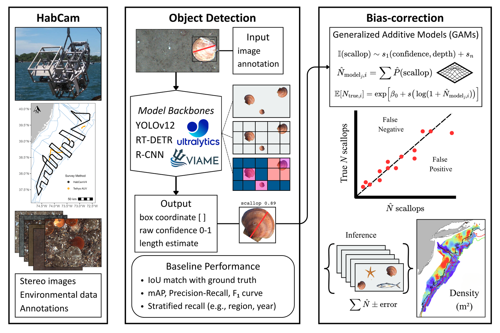

# PEMAD-ESB-ScalPred

## Maintainer

Name: Jeremy J

Email: jeremy.jenrette@noaa.gov

## Disclaimer

This repository is a scientific product and is not official communication of the National Oceanic and Atmospheric Administration, or the United States Department of Commerce. All NOAA GitHub project code is provided on an ‘as is’ basis and the user assumes responsibility for its use. Any claims against the Department of Commerce or Department of Commerce bureaus stemming from the use of this GitHub project will be governed by all applicable Federal law. Any reference to specific commercial products, processes, or services by service mark, trademark, manufacturer, or otherwise, does not constitute or imply their endorsement, recommendation or favoring by the Department of Commerce. The Department of Commerce seal and logo, or the seal and logo of a DOC bureau, shall not be used in any manner to imply endorsement of any commercial product or activity by DOC or the United States Government.

## Description

PEMAD-ESB-ScalPred turns object-detector outputs on HabCam benthic imagery into bias-corrected counts, densities and shell heights of Atlantic sea scallops (*Placopecten magellanicus*). It is the analysis code for Jenrette et al., *Automatically counting and measuring Atlantic sea scallops (Placopecten magellanicus) from underwater imagery with object detection and bias-correction* (Ecological Informatics, in revision).

Detectors (YOLOv12n, Cascade R-CNN and RT-DETR-L) are trained in the companion repository [PEMAD-ESB-ScalTrain](https://github.com/jeremyjenrette-NOAA/PEMAD-ESB-ScalTrain) ([10.5281/zenodo.23967411](https://doi.org/10.5281/zenodo.23967411)). This repository takes their boxes and confidences, plus each image's metadata, and calibrates them in two stages with generalized additive models (GAMs):

1. **Detection level (false positives).** A binomial GAM with a logit link gives each detection's probability of being a scallop from its confidence and, where selected, image and environmental covariates. Summing the probabilities in an image gives its expected number of true detections, N̂ = Σ p.
2. **Image level (missed scallops).** A Tweedie GAM with a log link predicts the manual count from ℓ = log(1 + N̂) and image features describing detection confidence and crowding (the share of detections below the regional F1 threshold, median box size, box overlap and nearest-neighbour spacing).

Model forms are chosen by five-fold block cross-validation on whole transect blocks. The recommended workflow is YOLOv12n with two-stage calibration, refitted each survey year on a systematic annotated subsample (about 0.3% of survey frames was enough in 2026).



## Reproducing the manuscript

This repository reproduces every calibration, abundance and size result in Jenrette et al., *Automatically counting and measuring Atlantic sea scallops (Placopecten magellanicus) from underwater imagery with object detection and bias-correction* (Ecological Informatics, in revision). Detector training is in the companion repository [PEMAD-ESB-ScalTrain](https://github.com/jeremyjenrette-NOAA/PEMAD-ESB-ScalTrain); you do not need it to reproduce the results, because the detector outputs are in the data record.

**1. Get the data.** Download `pipeline_inputs.zip` from the Zenodo data record ([10.5281/zenodo.23481212](https://doi.org/10.5281/zenodo.23481212); the DOI is reserved and resolves once the record is published with the paper) and unzip it in the repository root. It recreates `data/raw/` and `data/raw_model/` exactly as the scripts read them (check with `md5sum -c checksums_pipeline_inputs.md5`). The record's cleaned tables (`image_metadata.csv`, `annotations.csv`, `detections_<model>.csv`) document the same data with readable column names; the Calibration-set images are only needed to rerun the detectors.

**2. Install.** R (>= 4.3) with `mgcv`, `dplyr`, `tidyr`, `ggplot2`, `patchwork`, `stringr`, `janitor`, `scales`, `ranger`, `xgboost`, `maps` and `marmap`; Python 3 with `pip install -r requirements.txt` (pandas, numpy, scipy, matplotlib). No GPU is needed.

**3. Run.** From `s/`, run `./reproduce_paper.sh` (about 8–10 h on a laptop; most of it is cross-validation, which is cached after the first run). Each step logs to `s/logs/`; if one fails, fix it and restart from that step, e.g. `./reproduce_paper.sh n3_ablation`. Figures are written to `figures/ms_figures/` and LaTeX tables to `s/tables/`.

| Manuscript item | Script (run from `s/` unless noted) |
|---|---|
| Fig. 2 (study design) | `fig2_design.R` |
| Fig. 3, Table S1 (detection performance) | `performance.R` |
| Table 1 (detection-level model selection) | `gamstrat.R`, then `tables/make_table2.py` |
| Table 2 (image-level model selection), Table S5 (ablation) | `n3/n3_ablation.R`, then `n3/make_n3_tables.py` |
| Fig. 4 (ablation) | `n3/plot_n3_ablation.py` |
| Fig. 5, Fig. S2 (Holdout test counts and totals) | `n3/n3_export_holdout.R`, then `fig_holdout.R` |
| Fig. 6, Fig. S9 (error by covariate and image feature), Table S2 | `error.R`, then `tables/make_tableS1.py` |
| Fig. 7, Figs. S6–S7, Table S4 (shell height) | from `length/`: `match_size_pairs.py`, then `size_revision.R` |
| Fig. S1 (stratification) | `strat_vis.R` |
| Table S3, Fig. S3 (independent 2026 survey test) | `tierb/tierb_calibration.R` |
| Fig. S4 (annotation effort; fixed and rotating holdout) | `tierb/tierb_effort.R`, `tierb/tierb_effort_cv.R`, then `revision_figs.py` |
| Fig. S5 (leave-one-year-out calibration) | `tiera/tiera_loyo.R`, then `revision_figs.py` |
| Fig. S8 (error by depth and density) | `n11_depth.R` |
| Table S6, Fig. S10 (random forest and boosted trees) | `n3/n6_ml_compare.R` |
| Table S7 (density) | `n7_density.R` |
| Fig. S11, Table S8 (fitted GAMs and inputs) | `n3/plot_final_gams.R`, `tables/make_tableS7_covariates.R` |

The 2026 split (`dataset_split_tierb2026.csv`) is shipped in the record; `tierb/split_tierb2026.py` documents how it was drawn.

## Repository layout

```
s/                  calibration, evaluation and figure scripts (run from s/)
  makedat.R           joins detections, annotations and metadata -> data/processed/eval_2226.rds
  gamstrat.R          detection-level GAM selection by block CV (Table 1)
  gammod.R            image-level inputs and the original image-level GAMs
  performance.R       precision-recall and F1 curves (Fig. 3, Table S1)
  error.R             Holdout test error by covariate, image feature and space (Fig. 6, Fig. S9)
  n3/                 ablation of calibration steps and detectors, image-level selection,
                      random forest / boosted trees, fitted-GAM figure
  tierb/              independent 2026 survey test and annotation effort
  tiera/              leave-one-year-out calibration test
  tables/             scripts that write the LaTeX tables
  *func.R             shared functions (data, fitting, cross-validation, plotting)
  reproduce_paper.sh  runs everything in order (see above)
  run_pipeline.sh     core pipeline only: makedat -> gamstrat -> gammod -> error
length/             shell-height matching and validation (Fig. 7, Figs. S6-S7, Table S4)
pred/               survey-wide inference: run YOLOv12n (yolo_deploy/) or Cascade R-CNN
                    (viame_project2224/) on new imagery
data/               not tracked; filled from the Zenodo record (pipeline_inputs.zip)
figures/            not tracked; written by the scripts
```

## Applying the calibration to new imagery

1. Run a trained detector over the survey images: `pred/yolo_deploy/` (YOLOv12n, Windows or Linux) or `pred/viame_project2224/` (Cascade R-CNN in VIAME). Trained weights are in the data record.
2. Annotate a systematic subsample of the same survey (about one frame in 333 was enough in 2026), and evaluate the detector on it with the matching scripts in PEMAD-ESB-ScalTrain.
3. Refit both GAM stages on that subsample and predict every image. `tierb/tierb_calibration.R` is the reference implementation of this single-survey refit (it is what the paper's independent 2026 test runs). `pred/inference_run.R` applies the detection-level GAMs to survey-wide detections but still uses the image-level models of the original submission and is not part of the paper's results.

Calibration models fitted on other years should not be reused unchanged: in our tests they did not transfer to densities those years lacked.

## Citation

If you use this code, please cite the paper and the archived release:

Jenrette, J.F., Hart, D.R., Chang, J.-H., Fairclough, C., McManus, M.C. PEMAD-ESB-ScalPred: two-stage GAM calibration, abundance and shell-height analysis for automated sea scallop counts. Zenodo. https://doi.org/10.5281/zenodo.23967377

Data: https://doi.org/10.5281/zenodo.23481212 (resolves once the record is published with the paper)

## License

Apache License 2.0 (see `LICENSE`). The data record is released under CC0 1.0.

## Contact

Jeremy F. Jenrette, NOAA Fisheries, Northeast Fisheries Science Center (jeremy.jenrette@noaa.gov)
