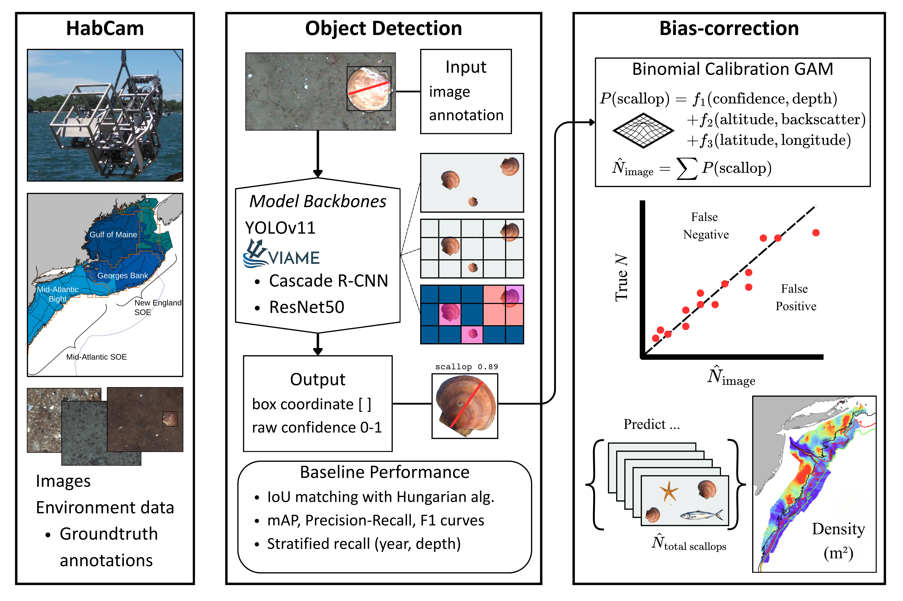
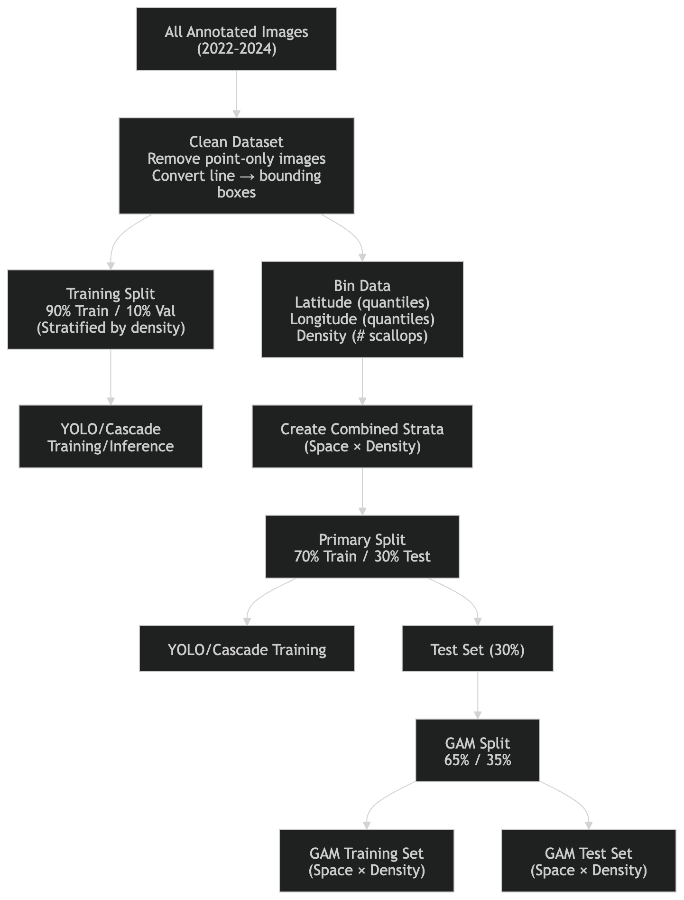
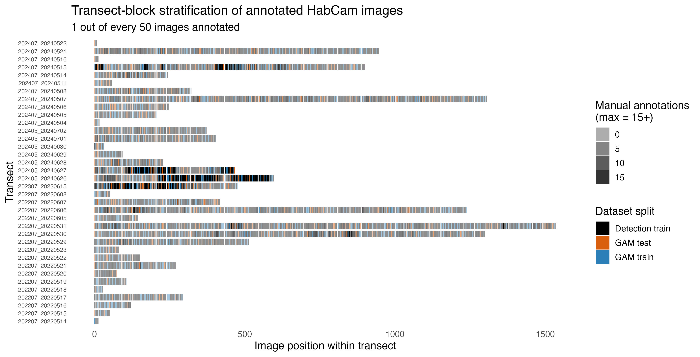
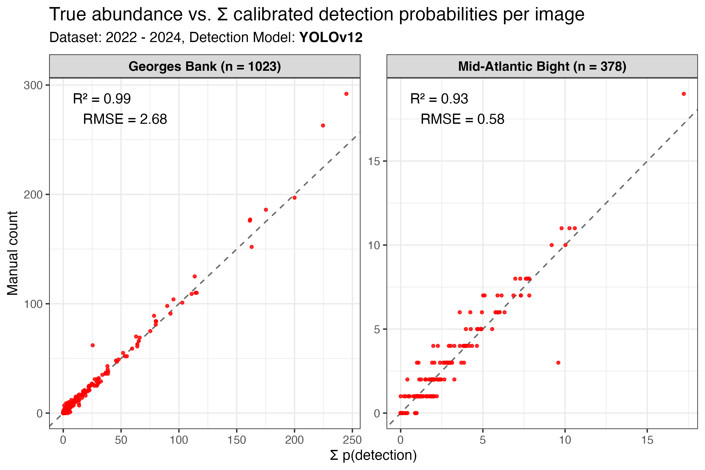
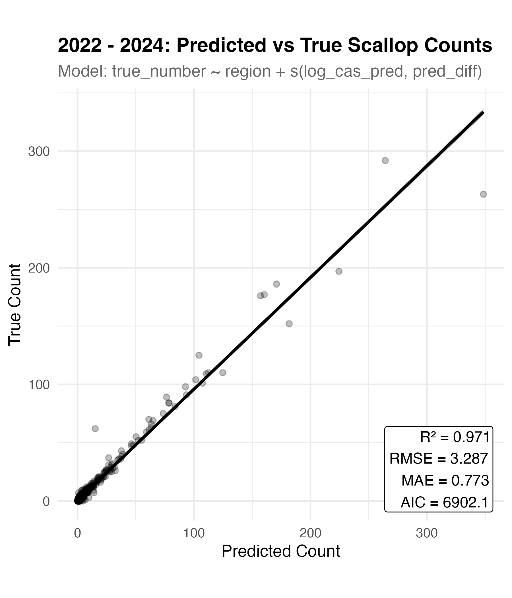
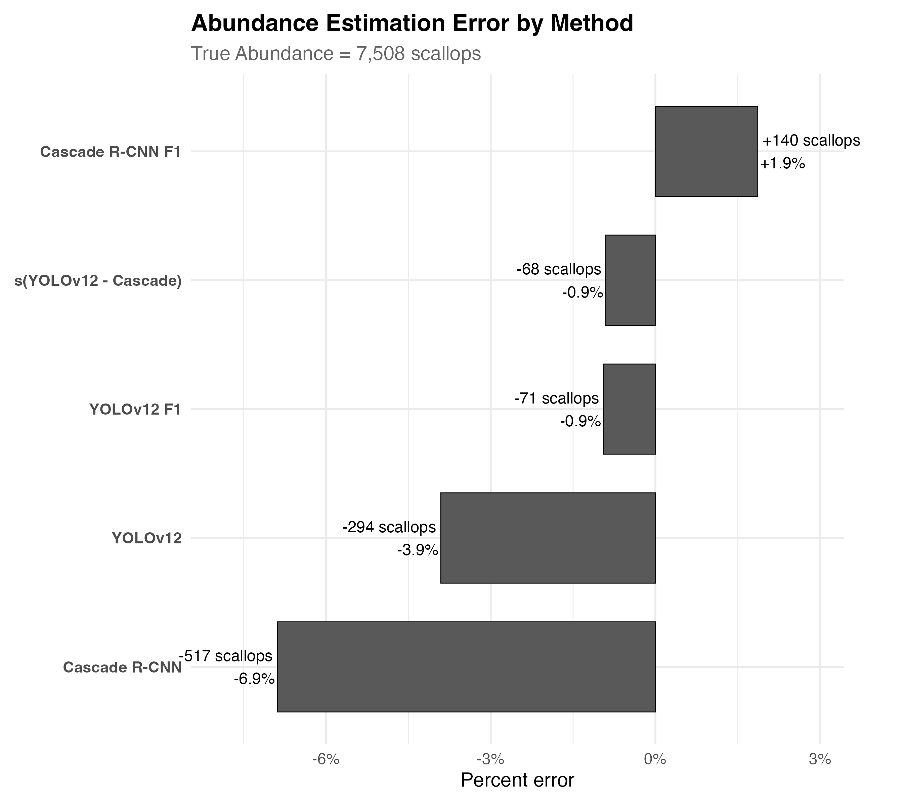

# PEMAD-ESB-ScalPred

## Maintainer

Name: Jeremy J

Email: jeremy.jenrette@noaa.gov

## Disclaimer

This repository is a scientific product and is not official communication of the National Oceanic and Atmospheric Administration, or the United States Department of Commerce. All NOAA GitHub project code is provided on an ‘as is’ basis and the user assumes responsibility for its use. Any claims against the Department of Commerce or Department of Commerce bureaus stemming from the use of this GitHub project will be governed by all applicable Federal law. Any reference to specific commercial products, processes, or services by service mark, trademark, manufacturer, or otherwise, does not constitute or imply their endorsement, recommendation or favoring by the Department of Commerce. The Department of Commerce seal and logo, or the seal and logo of a DOC bureau, shall not be used in any manner to imply endorsement of any commercial product or activity by DOC or the United States Government.

## Description
PEMAD-ESB-ScalPred is a framework for automated detection, abundance estimation, and size inference of Atlantic sea scallops (***Placopecten magellanicus***) from large-scale benthic imagery collected by the HabCam system.

The project integrates the latest object detection models (YOLO and Cascade R-CNN with VIAME) with statistical calibration workflows to address well-known sources of bias in image-based ecological surveys, including false positives, false negatives, and environmental variability. The resulting outputs provide spatially and temporally scalable estimates of scallop abundance and size structure, supporting fisheries assessment and ecosystem monitoring.

This repository contains the code necessary to evaluate trained raw model outputs with image metadata. Here, we can train Generative Additive Models (GAMs), perform inference, predict calibrated abundance estimates, and predict length classes.  Included are figures and diagnostic plots. To see the **Detection Training** repository, visit...

### Project



PEMAD-ESB-ScalPred provides:

* Automating scallop detection across multi-year survey datasets (2022–2024)
* Integrating predictions with environmental and survey metadata
* Calibrating detection outputs using Generative Additive Models
* Converting raw detections into biologically meaningful quantities:

  * **Density (n m⁻²)**
  * **Length distributions (mm)**
  * **Spatial abundance patterns**

```
.
├── data
│   ├── images # diagnostic images
│   │   ├── 202203.20220515.135703301.59728.png
│   │   └── 202203.20220515.224949946.9971.png
│   │
│   ├── processed
│   │   ├── Cas2224.RData # VIAME trained + evaluated model paired with metadata
│   │   ├── YOLOv122224.RData # YOLOv12 trained + evaluated paired with metadata
│   │   ├── completed/ # these are all images processed by the detection model
│   │   │   └── completed_yolo_2024.txt
│   │   ├── detections/ # these are all images WITH DETECTIONS
│   │   │   └── detections_yolo_2024.csv
│   │   └── metapred/ # metadata folder
│   │       └── meta_all2224.csv
│   │
│   └── raw # evaluated models and raw weights, also contains other unprocessed data
│       ├── 2022scallop_viame_257794/
│       │   └── run_summary.csv
│       ├── 2022scallop_yolo11n_242222/
│       │   ├── results.csv
│       │   └── weights/
│       │       └── best.pt
│       └── groundtruth2224.csv
│
├── doc
│
├── figures
│   ├── 2224_caldense.jpg
│   ├── 2224_lengthdist.jpg
│   ├── 2224_totalcal.jpg
│   ├── 2224yolov12cas_gammod.png
│   ├── NEFSC-scal-flowchart.png
│   └── diag1/
│       └── 2224_yolo_compare_m7.jpg
│
├── length # for calculating length from boxes and other diagnostics
│   ├── findlengths.R
│   └── lengthfunc.R
│
├── pred # for dataset-wide inference using YOLO and Cascade R-CNN
│   ├── calpred.R
│   ├── predfunc.R
│   ├── predict_habcam_yolo.py
│   ├── imglist.sh
│   ├── view_overlap.R
│   └── viame_project2224/
│       ├── category_models/
│       │   └── detector.pipe
│       ├── pipelines/
│       │   └── detector_project_folder.pipe
│       ├── predict_habcam_viame.py
│       ├── run_trained_model.sh
│       └── README_PROJECT_FOLDER.md
│
├── s # data-processing and visualization scripts
│   ├── datfunc.R
│   ├── fitfunc.R
│   ├── gammod.R
│   ├── gamstrat.R
│   ├── strat_vis.R
│   ├── performance.R
│   └── procfunc.R
│
├── tex # LaTeX
│   ├── main.tex
│   ├── main.pdf
│   └── compile_main.sh
│
├── README.md
├── requirements.txt
└── LICENSE
```

## Reproducing the manuscript

This repository (release `v1.1-revision1`) reproduces every calibration, abundance and size result in Jenrette et al., *Automatically counting and measuring Atlantic sea scallops (Placopecten magellanicus) from underwater imagery with object detection and bias-correction* (Ecological Informatics, in revision). Detector training is in the companion repository [PEMAD-ESB-ScalTrain](https://github.com/jeremyjenrette-NOAA/PEMAD-ESB-ScalTrain); you do not need it to reproduce the results, because the detector outputs are in the data record.

**1. Get the data.** Download `pipeline_inputs.zip` from the Zenodo data record ([10.5281/zenodo.23481212](https://doi.org/10.5281/zenodo.23481212)) and unzip it in the repository root. It recreates `data/raw/` and `data/raw_model/` exactly as the scripts read them (check with `md5sum -c checksums_pipeline_inputs.md5`). The record's cleaned tables (`image_metadata.csv`, `annotations.csv`, `detections_<model>.csv`) document the same data with readable column names; the Calibration-set images are only needed to rerun the detectors.

**2. Install.** R (>= 4.3) with `mgcv`, `dplyr`, `tidyr`, `ggplot2`, `patchwork`, `stringr`, `janitor`, `scales`, `ranger`, `xgboost`, `maps` and `marmap`; Python 3 with `pip install -r requirements.txt` (pandas, numpy, scipy, matplotlib). No GPU is needed.

**3. Run.** From `s/`, run `./reproduce_paper.sh` (about 8–10 h on a laptop; most of it is cross-validation, which is cached after the first run). Each step logs to `s/logs/`; if one fails, fix it and restart from that step, e.g. `./reproduce_paper.sh n3_ablation`. Figures are written to `figures/ms_figures/` and LaTeX tables to `s/tables/`.

| Manuscript item | Script (run from `s/` unless noted) |
|---|---|
| Fig. 2 (study design) | `fig2_design.R` |
| Fig. 3, Table S1 (detection performance) | `performance.R` |
| Table 1 (detection-level model selection) | `gamstrat.R`, then `tables/make_table2.py` |
| Table 2 (image-level model selection), Table S5 (ablation) | `n3/n3_ablation.R`, then `n3/make_n3_tables.py` |
| Fig. 4 (ablation) | `n3/plot_n3_ablation.py` |
| Fig. 5, Fig. S2 (Holdout test counts and totals) | `n3/n3_export_holdout.R`, then `fig_holdout.R` |
| Fig. 6, Fig. S9 (error by covariate and image feature), Table S2 | `error.R`, then `tables/make_tableS1.py` |
| Fig. 7, Figs. S6–S7, Table S4 (shell height) | from `length/`: `match_size_pairs.py`, then `size_revision.R` |
| Fig. S1 (stratification) | `strat_vis.R` |
| Table S3, Fig. S3 (independent 2026 survey test) | `tierb/tierb_calibration.R` |
| Fig. S4 (annotation effort; fixed and rotating holdout) | `tierb/tierb_effort.R`, `tierb/tierb_effort_cv.R`, then `revision_figs.py` |
| Fig. S5 (leave-one-year-out calibration) | `tiera/tiera_loyo.R`, then `revision_figs.py` |
| Fig. S8 (error by depth and density) | `n11_depth.R` |
| Table S6, Fig. S10 (random forest and boosted trees) | `n3/n6_ml_compare.R` |
| Table S7 (density) | `n7_density.R` |
| Fig. S11, Table S8 (fitted GAMs and inputs) | `n3/plot_final_gams.R`, `tables/make_tableS7_covariates.R` |

The 2026 split (`dataset_split_tierb2026.csv`) is shipped in the record; `tierb/split_tierb2026.py` documents how it was drawn.

## Workflow

The pipeline follows a structured, end-to-end workflow:

 
---

### 1. Data Ingestion and Preparation

**Inputs**

* `autotest` → automated detections
* `mantest` → ground-truth annotations
* metadata → environmental + image-level covariates

**Scripts**

* `makedat.R` → data loading and formatting
* `datfunc.R` → processing functions + table construction

**Process**

1. Load `autotest`, `mantest`, and metadata using `makedat.R`
2. Pass inputs to `build_detection_tables()`
3. Perform spatial matching between detections and annotations
4. Assign detection labels:

   * True Positive (TP)
   * False Positive (FP)

* Stratify both tables by region (e.g., GB vs. MAB)

**Outputs**

* **Detection-level table**

  * One row per detection
  * Includes TP/FP classification

* **Image-level table**

  * One row per image
  * `n_auto` → number of automated detections
  * `n_manual` → number of ground-truth annotations

* For subsequent steps, load saved model data with `load("../data/processed/YOLOv122224.RData")`

---

### 2. Model Performance

**Scripts**

* `performance.R` → data loading and formatting
* `procfunc.R` → processing functions + table construction

* Object detection models trained using:

  * **YOLO (Ultralytics)** - tested with v11, v12, v26
  * **Cascade R-CNN (VIAME framework)**
* Model outputs include:

  * Bounding boxes
  * Confidence scores
  * IoU, match boolean via Hungarian Algorithm `truedetect`
* Performance evaluated using held-out datasets (F1, precision-recall) `evaluate_pr_models()`

---

### 3. Prediction Calibration

* Detection-level predictions are calibrated using **Generalized Additive Models (GAMs)**
* Calibration accounts for:

  * Environmental conditions (e.g., depth, backscatter, turbidity)
  * Detection uncertainty (confidence scores)
* Produces **probabilistic detection estimates** (p(detection))

**Scripts**

* `strat_vis.R` → training data stratitifcation visualization

<div style="text-align: center;">
    
</div>

* `gamstrat.R` → data loading and metric visualization

<div style="text-align: center;">
    
</div>

* `gamfunc.R` → prediction and plotting functions
* `fitfunc.R` → detection-level GAMs by region
* `gammod.R` → image-level GAM

**Modeling**
* stratified by *region* and *detection model*

$$
P(\text{Scallop}_i)  =
f_1(\mathrm{conf}_i,\mathrm{bottomDepth}_i) +
f_2(\mathrm{altitude}_i,\mathrm{backscatter}_i) +
f_3(\mathrm{latitude}_i,\mathrm{longitude}_i)
$$

$$
P(\text{TotalCount}_i) = \text{region}_i +
f[\mathrm{Cascade}_i,\mathrm{(Cascade - YOLO)}_i]
$$

<div style="text-align: center;">
    
</div>

<div style="text-align: center;">
    
</div>


**Outputs**

* **Predictions & Diagnostic plots**

  * Raw confidence --> P(Detection)
  * True vs. predicted counts (stratified by region and includes F_1 score cutoff)
  * Calibration by depth visual


### 4. Dataset-wide Inference

Folders 
* `pred/`
* `viame_project2224/`

**Scripts**

* `predict_habcam_yolo.py` → runs trained YOLO model on year-specified HabCam dataset
Run:
```
nohup python predict_habcam_yolo.py \
  --model ../models/2224scallop_yolo12n_261070/weights/best.pt \
  --inventory img_inventory_out/img_inventory_2022_2024_compiled.tsv \
  --outdir pred_out_2023_2 \
  --year 2023 \
  --model_name YOLOv12 \
  --split right \
  --process_col process_image15 \
  --batch_size 16 \
  --device 1 \
  --conf 0.01 \
  --nms_iou 0.65 \
  --imgsize 1024 \
  --max_detections 300 > predict_2023.log 2>&1 &
```

* `run_trained_model.bat` → runs trained VIAME-based Cascade R-CNN model year-specified HabCam dataset
    - customize this script for model, year, `input_list.txt`
    - designed for Windows-based processing

* Trained models deployed across full survey datasets
* Outputs stored as:

  * `detections_*.csv` (detections only)
  * `completed_*.txt` (all processed images)

---


### 5. Abundance Estimation

**Scripts**

* `calpred2.R` → load GAMs, predict, diagnostics, estimate abundance

* Image-level abundance computed as:

$$
\hat{N}_{\text{image}} = \sum_i p_i
$$

* Density using field-of-view metadata:

$$
\hat{D} = \frac{\sum_i p_i}{\text{area}_{\text{image}}}
$$

---

### 6. Length Estimation

**Scripts**

* `findlengths.R` → show stereo lengths, plot diagnostics, simulate sample effort
* `lengthfunc.R` → functions to convert box to line and simulate sample size

* Bounding boxes converted to scallop length using pixel-to-mm scaling
* Produces:

  * Individual size estimates
  * Population-level length distributions

---

### 7. Visualization and Diagnostics

* Model comparisons (YOLO vs Cascade R-CNN)
* Calibration diagnostics
* Spatial and depth-based trends
* Length-frequency distributions

Outputs are stored in `/figures` and used for manuscript development.

---

## Results

This framework demonstrates that:

* Deep learning models can reliably detect scallops across heterogeneous benthic environments
* **Calibration is essential** to correct systematic detection bias
* Probabilistic predictions outperform threshold-based counting approaches
* Automated workflows can produce:

  * **Accurate abundance estimates**
  * **Robust size distributions**
  * **Scalable survey analytics**

Across the 2022–2024 datasets, the pipeline enables:

* Processing of **millions of images**
* Generation of **survey-wide density estimates**
* Consistent comparison across models and years

---

## Key Contributions

* End-to-end pipeline linking **computer vision → statistical ecology**
* Integration of **multiple detection frameworks** in a unified workflow
* Explicit handling of **false positives and false negatives**
* Scalable methodology for **image-based fisheries assessment**

---

## Contact